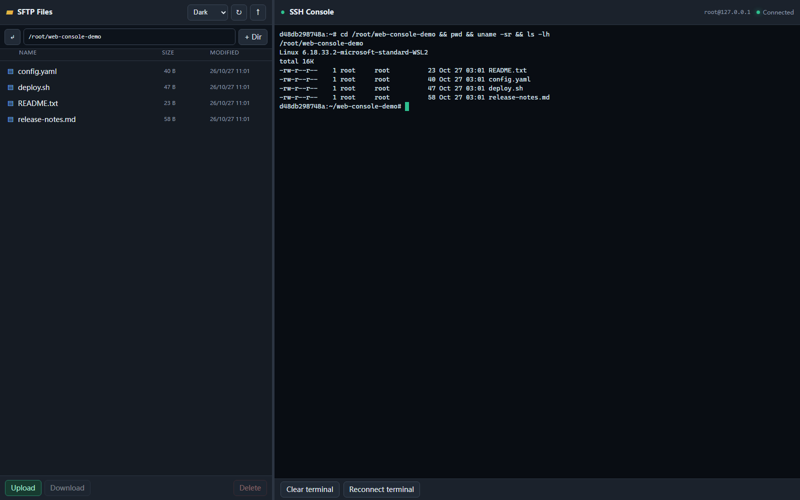

# win-sshpass

[](https://github.com/chuccp/win-sshpass/releases)
[](LICENSE)
[](go.mod)
[](https://github.com/chuccp/win-sshpass/releases)

[English](README.md) · [简体中文](README.zh-CN.md) · [繁體中文](README.zh-TW.md) · [日本語](README.ja.md)

`win-sshpass` is a cross-platform SSH client designed for AI-driven automation
on Windows, Linux, and macOS. It combines non-interactive password/key
authentication, SFTP and SCP/Rsync-style transfers, port forwarding, a
browser-based SSH workspace, MCP tools, JSON output, and a reusable Go SDK.

## Highlights

- SSH with password, private key, ssh-agent, or explicit empty password.
- Remote commands, JSON output, retry, timeout, proxy, and `known_hosts`.
- Interactive terminal, `--bg`, and shell transfer via `rz` / `sz`.
- SFTP upload/download, recursive directories, multiple files, and resume.
- Local/remote port forwarding and SOCKS4/SOCKS5/HTTP/HTTPS proxies.
- Full-screen Web SSH console with SFTP file manager and xterm.js PTY.
- Drag-and-drop transfers, upload percentage, resizable panes, light/dark themes.
- MCP tools for SSH execution and SFTP file operations.
- Self-update, SSH key generation, hash, and verify commands.

## Install

```powershell
winget install chuccp.win-sshpass
```

```powershell
scoop bucket add chuccp https://github.com/chuccp/scoop-bucket
scoop install win-sshpass
```

Or download the archive, MSI, or PKG from
[GitHub Releases](https://github.com/chuccp/win-sshpass/releases).

No external runtime is required.

## Quick Start

```bash
# Run a command
win-sshpass -p 'password' ssh root@example.com 'whoami'

# Open an interactive shell
win-sshpass -p 'password' ssh root@example.com

# Upload and download
win-sshpass -h example.com -p 'password' -local ./app.jar -remote /tmp/app.jar
win-sshpass -h example.com -p 'password' -d -remote /tmp/app.log -local ./app.log

# Start the Web SSH console at http://127.0.0.1:6326
win-sshpass -web -h 127.0.0.1 -u root -P 22 -p 'password'
```

The command must include an SSH host, either through `-h` or `-f`. Open
<http://127.0.0.1:6326> to enter the connected workspace directly.

## Web Console



The Web workspace is designed for managing files and a live SSH session:

- Left: SFTP directory browser, upload/download, mkdir, delete, drag-and-drop.
- Right: real SSH PTY rendered with xterm.js; supports vim/top and Tab completion.
- Center divider: drag or use arrow keys to resize; width is remembered.
- Themes: System by default, plus explicit Light and Dark.
- Upload footer: aggregate file count, filename, progress bar, and percentage.

Bare `win-sshpass -web` is rejected. Supply a host, user and authentication
option on the command line, or use a config file:

```bash
win-sshpass -f server.config -web
```

Change the listener deliberately if needed:

```bash
win-sshpass -web -h example.com -u root -p 'password' -web-addr 127.0.0.1:6326
```

The default is loopback-only.

## MCP

The Web server exposes MCP Streamable HTTP at:

```text
http://127.0.0.1:6326/mcp
```

Example Codex configuration:

```toml
[mcp_servers.win-sshpass]
url = "http://127.0.0.1:6326/mcp"
```

Available tools:

- `ssh_exec`
- `sftp_list`
- `sftp_read`
- `sftp_write`
- `sftp_mkdir`
- `sftp_delete`

MCP reuses the SSH connection supplied with `-web` and maintains its own
`Mcp-Session-Id`.

## Common Commands

| Task | Command |
|---|---|
| Private key | `win-sshpass -i ~/.ssh/id_ed25519 ssh user@host` |
| Environment password | `SSHPASS='pass' win-sshpass -e ssh user@host` |
| Password file | `win-sshpass -f pass.txt ssh user@host` |
| Config file | `win-sshpass -f server.config 'docker ps'` |
| Custom port | `win-sshpass -p 'pass' ssh -p 2222 user@host` |
| Operation timeout | `win-sshpass -t 30 -p 'pass' ssh user@host 'long-task'` |
| SOCKS5 proxy | `win-sshpass -proxy socks5://127.0.0.1:1080 ssh user@host` |
| SCP upload | `win-sshpass -p 'pass' scp -P 2222 file.txt user@host:/tmp/` |
| Rsync upload | `win-sshpass -p 'pass' rsync -avz ./ user@host:/backup/` |
| Generate key | `win-sshpass keygen -algo ed25519` |
| Hash / verify | `win-sshpass hash sha256 file.iso` |
| Update | `win-sshpass update -check` |

## Configuration

```yaml
host: 192.168.1.10
username: root
password: secret
port: 22
timeout: 0
strict_host_key: false
```

Run a command with the file:

```bash
win-sshpass -f server.config 'docker ps'
```

See the [configuration guide](https://chuccp.github.io/win-sshpass/en/guide/config-file/)
for key, proxy, timeout, retry, and background options.

## Go SDK

```go
cfg := sshpass.NewConfig()
cfg.Host = "example.com"
cfg.User = "root"
cfg.Password = "secret"

client, err := sshpass.NewClient(cfg)
if err != nil {
    log.Fatal(err)
}
defer client.Close()

if err := client.Exec("uname -a"); err != nil {
    log.Fatal(err)
}
```

```bash
go get github.com/chuccp/win-sshpass
```

See the [Go SDK guide](https://chuccp.github.io/win-sshpass/en/advanced/sdk/).

## Documentation

- [English](https://chuccp.github.io/win-sshpass/en/)
- [简体中文](https://chuccp.github.io/win-sshpass/zh/)
- [繁體中文](https://chuccp.github.io/win-sshpass/tw/)
- [日本語](https://chuccp.github.io/win-sshpass/ja/)
- [Documentation source](https://github.com/chuccp/win-sshpass/tree/main/docs-site)

Detailed guides cover installation, Web/MCP, SSH, shell, file transfer,
SCP/Rsync, configuration, proxies, forwarding, the SDK, and best practices.

## Development

```bash
go test -race ./...
go vet ./...
go build -o win-sshpass.exe ./cmd/sshpass
```

Cross-compilation examples:

```bash
GOOS=linux GOARCH=amd64 CGO_ENABLED=0 go build -o win-sshpass ./cmd/sshpass
GOOS=darwin GOARCH=arm64 CGO_ENABLED=0 go build -o win-sshpass ./cmd/sshpass
```

## License

Apache-2.0. See [LICENSE](LICENSE).
